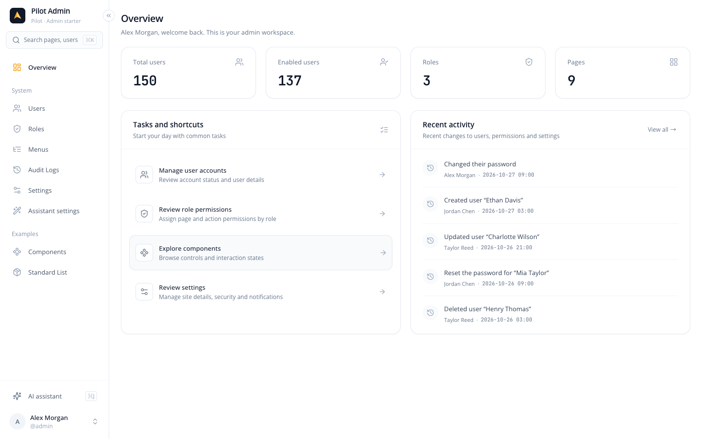
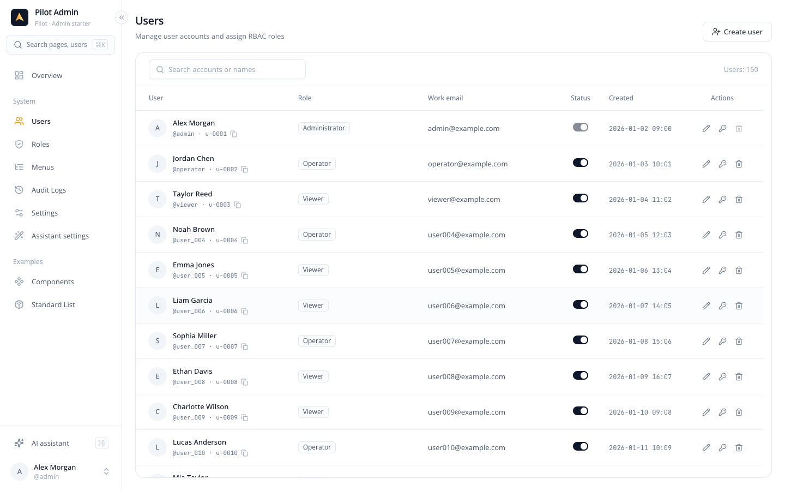
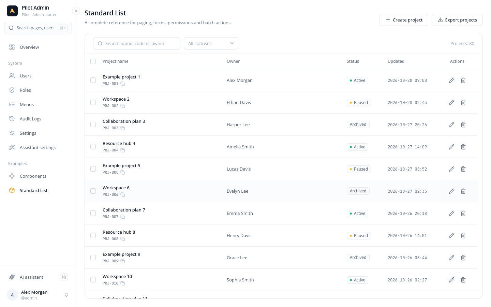
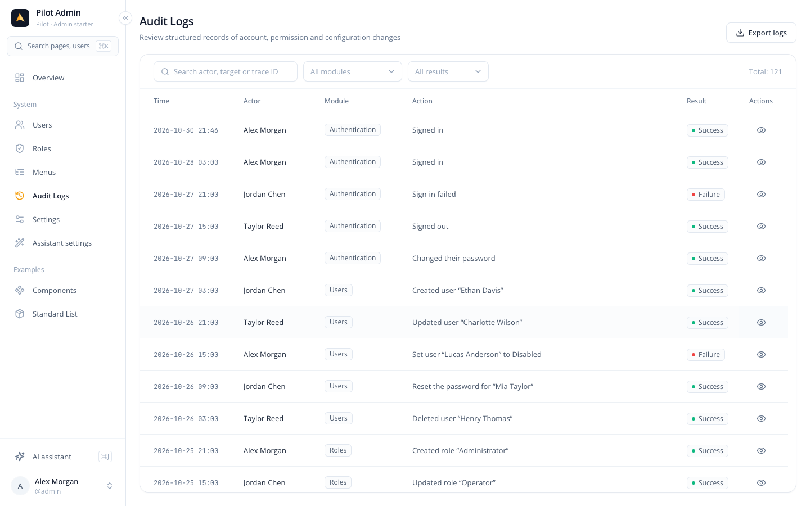
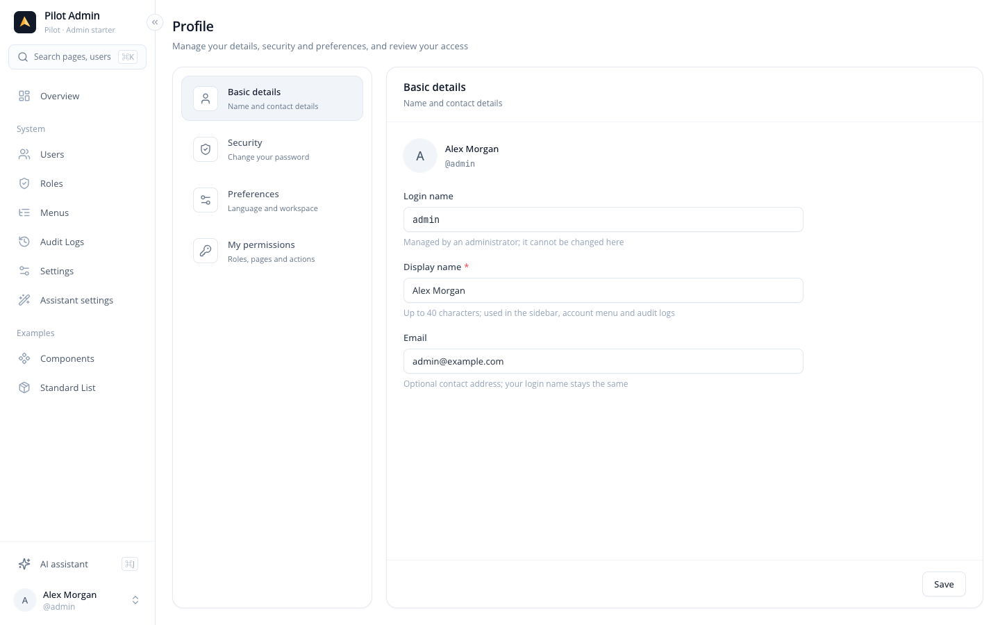
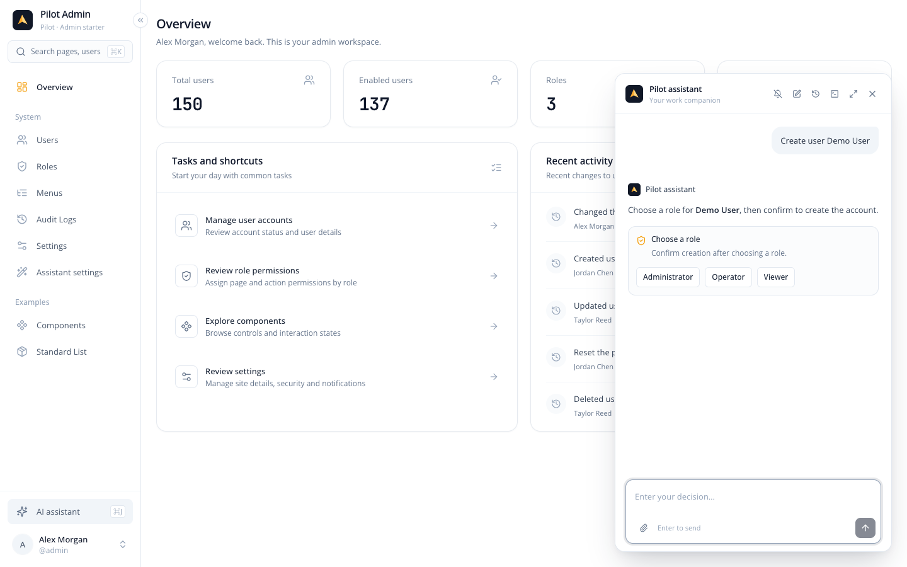
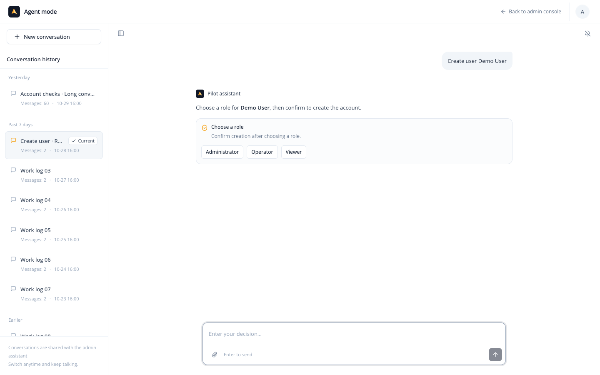

[中文](README.md) | English

# Pilot Admin

[](https://github.com/kohlarnhin/pilot-admin/actions/workflows/ci.yml)
[](https://github.com/kohlarnhin/pilot-admin/actions/workflows/deploy-pages.yml)
[](LICENSE)
[](https://nodejs.org/)

**[Live demo →](https://kohlarnhin.github.io/pilot-admin/)** Demo data lives in the visitor's browser, with no backend requests; demo accounts are in the table below.

A fork-ready React admin starter with a compact design system, mock authentication and RBAC, system pages, an assistant panel and a full-screen Agent workspace. Data and assistant execution stay in the browser: the default demo sends no backend requests and calls no real model. The shell, admin pages, service messages, demo data, assistant conversations and tools support zh-CN / en-US.

## Features

- React 19, strict TypeScript, Vite 6, Tailwind 3.4, Radix, zustand 5 and react-router 7.
- Fixed sidebar, independent scroll regions, shared controls, a component gallery, virtualized infinite lists and route preloading.
- Dashboard, global search, user / role / menu / settings pages, menu and button permissions.
- One assistant runtime shared by the panel and Agent mode, with account-isolated drafts and sessions, confirmations, plans and metadata-only attachments.
- Replaceable services, HTTP / SSE integration seams, persistent local demo data, ESLint and build CI.

## Screenshots

1440×900 with seeded demo data. Expand to see all screens.

<details>
<summary>Screenshots</summary>

**Overview**



**Users**



**Standard List**



**Audit Logs**



**Profile**



**Assistant panel**



**Agent mode**



</details>

## Quick start

Use Node 22+ and pnpm 10. The repository pins pnpm 10.8.0 through `packageManager`; `.nvmrc` selects Node 22.

```sh
pnpm install --frozen-lockfile
pnpm dev
```

Open http://localhost:3300. No `.env` file or backend is required.

| Account | Password | Access |
| --- | --- | --- |
| `admin` | `admin123` | All pages and actions, including audit logs, assistant and model settings |
| `operator` | `operator123` | Overview, user read/edit, Components, Standard List create/edit/export and assistant; no project delete, user create/delete or audit logs |
| `viewer` | `viewer123` | Overview, Components and Standard List read/export; no assistant or audit logs |

Every account has a Profile page. Reset demo data to apply the Standard List's default grants to existing local data.

On first login, eligible accounts can choose the admin console or Agent mode. Ctrl/⌘K opens search; Ctrl/⌘J opens the assistant. Account preferences can remember the entry mode. The demo seeds 150 users, three roles and 25 admin sessions, including a 60-message conversation. Writes persist in browser localStorage; this is not a server account system.

## Directory overview

```text
src/config/                Branding and static menu/button definitions
src/ui/                    Shared controls and feedback
src/components/            Layout, navigation, search and assistant runtime/UI
src/agent/                 Full-screen Agent and entry preferences
src/api/services/          The only data seam; currently backed by mocks
src/api/http.ts, sse.ts    Real-backend integration helpers; unused by default
src/mock/                  Typed seed, local DB and agent engine/tools
src/hooks/, store/         Paging, virtualization and application state
src/pages/, routes/        Pages, routing and cached lazy loaders
src/types/, utils/         Shared types and utilities
tests/                    Node logic tests and browser stubs, mirroring src paths
vitest.config.ts          Standalone test configuration; no app entry or Vite plugins
e2e/                      Playwright real-browser journeys and isolated fixtures
playwright.config.ts      Chromium root/subpath production preview configuration
skills/pilot-ui-spec/      Portable UI contract and reference assets
.github/                  CI, Pages/Release workflows, Dependabot and bilingual Issue/PR templates
.vscode/extensions.json   Recommended editor extensions
scripts/release-notes.mjs  Versioned CHANGELOG section extraction
CODE_OF_CONDUCT.md        Contributor Covenant 2.1 and reporting route
CONTRIBUTING.md, CONTRIBUTING.en.md  Contribution guides
SECURITY.md, CHANGELOG.md, LICENSE   Security boundaries, history and license
```

## Extend the starter

Read [AGENTS.md](AGENTS.md) and the [UI specification](skills/pilot-ui-spec/SKILL.md) before changing the interface. Keep the visual system and existing dependencies.

### Rebrand

Edit `src/config/app.ts`, replace `src/components/logo/index.tsx` and `public/favicon.svg`, and adjust the brand tokens in `tailwind.config.js`. The bilingual default description is `common.appDescription` in the locale dictionaries; custom descriptions saved in settings keep their original text. Update assistant defaults in the seed and `agentProfileService.ts` if needed. Persisted branding takes precedence: reset demo data to see new seed values. [Full guide](README.md#换品牌).

### Add a page and permissions

Adding a page takes three steps:

1. Export the page from `src/pages/<feature>/index.tsx`.
2. Add one `definePage({ path, load })` entry to `adminPages` in `src/routes/routeModules.ts`. Routes and cached hover/focus preloading derive from it.
3. Add one menu entry with a stable ID, matching route and an icon name from `src/components/icon/registry.ts` to `src/config/menus.ts`. No route or icon-path mapping is needed elsewhere.

The default `access: 'menu'` checks an enabled, visible granted menu. Add `requires: ['feature:manage']` for extra permissions, or use `access: 'authenticated'` for a signed-in page without a menu, such as `/profile`. Add `titleKey: 'profile.title', searchable: true` to make it searchable by its localized title; title keys must have no placeholders. Guards, navigation, search and landing routes share `src/routes/access.ts`. Use `usePermission`, `useCan` or `<Access>` for buttons, and `useDataChanged` to refresh after assistant writes. Services must still check access.

Register details with `definePage({ path: '/examples/crud/:id', accessPath: '/examples/crud', load })`. The owner must be a registered static menu page; details also enforce their own `requires`. The shared `resolvePage` uses Router ranking, handles encoded segments and trailing slashes, and preserves ID case. Parameter pages are omitted from search and the profile page list. List links may pass `state.listSearch` to preserve the return query. Assistant cards and automatic navigation use the same access check and reject external paths.

Mock catalog sync is recursive, monotonic and add-only. Only the seeded admin role has the internal `auto_grant` flag; newly created roles do not. New permissions are granted on DB load/storage reload without resetting demo data or changing role seeds. Revoked old permissions stay revoked. All roles gain missing route-less ancestors of their existing menus; routed ancestors are never granted implicitly. Removed definitions remain inert and counts reflect current definitions. Other roles need explicit grants; real backends decide and enforce grants server-side. Custom menu names override defaults. [Full guide](README.md#添加页面与权限).

### Add a service or connect a backend

Pages call `src/api/services`; they never access the mock DB directly. For a new collection or incompatible shape, update types, deterministic seeds and full validation; bump `MOCK_DB_VERSION` and the seed/type version, then add each `fromVersion → nextVersion` function in `src/mock/migrations.ts`. Migrations must be pure and deterministic: no clock, randomness, locale, storage, `createId()`, `Date.now()` or `t()`. Derive new fields from old data or fixed anchors, and test preservation with old-version fixtures.

For v6 → v7, startup injects the active locale's `getSeedText()` into `createMockDbMigrations(seedText)`. Its pure migration calls the deterministic `createDirectorySeed(seedText, users)`, also used by initial seeds and demo reset. New folder/document names use the migration-time locale, while old collections and user edits remain intact. Switching locale does not translate persisted seed text; reset demo data to regenerate it in another language.

The injected storage core prefers a valid current key. Otherwise it migrates the highest supported lower key, validates, syncs the permission catalog, validates again and persists. Keep the source during this start; only a later start with an already-valid current key removes lower keys. Failed migrations use seed data without touching the source this time; failed persistence retains migrated data in memory. The current version is v7 with v5 as the migration starting point. The v5 → v6 migration preserves every collection and adds empty `importReceipts`; v6 → v7 adds `exampleFolders` and `exampleDocuments`. Older or corrupt data still falls back to seed.

### Tree directory reference

Examples → Tree directory (`/examples/directory?folder=folder-03`) is a read-only folder tree plus record table: 18 folders across three levels and 300 metadata-only documents, including an empty folder and a 140-document folder. Selection includes descendants; breadcrumbs navigate ancestors, keyword search matches document names and owners, and the table appends 20-row pages through its own scroller with virtualization. The independently scrolling tree keeps matching ancestors visible and supports WAI-ARIA keyboard navigation. The URL restores deep links and back/forward; unknown folders show all documents with an inline notice.

Copy `src/pages/examples/directory/`, `src/api/services/exampleDirectoryService.ts`, `src/mock/directorySeed.ts`, the entity types and locale messages. Reuse `src/utils/formatBytes.ts`; replace the service for departments/members, categories/products or folders/documents. `folder_path` starts at the selected folder, and its cell is omitted for documents directly in that folder. No content field, file body, write operation, button permission or audit is involved.

Fresh seeds grant this menu to admin, operator and viewer. Existing v5 / v6 databases auto-grant it only to `auto_grant` admins; other roles retain their grants and need a manual grant or demo reset. M9b v6 tabs become read-only after detecting v7 and must reload before writing or resetting.

A higher-version key makes the current build read-only: writes/reset fail with code `40990` and a localized reload message. Higher keys are never deleted. Even after removing a test key, reload to resume writes. Previously deployed builds without this guard cannot be controlled; close or reload those old tabs during upgrades. Use the existing paged response and infinite-list helpers. To connect a backend, replace service function bodies with `http` calls and use `runSseStream` for assistant streaming. Authentication and RBAC must be enforced on the server. [Services and mocks](README.md#添加-service-与-mock), [backend integration](README.md#接真实后端).

Mock services and pages import errors from lightweight `src/api/errors.ts`; importing `src/api/http.ts` in a real service loads Axios and still supports the original error imports.

### Add an assistant tool

Add trigger phrases to both `agentCommands.ts` dictionaries and use the shared `src/agent/commands.ts` parser for matching and argument extraction. It accepts phrases from both languages, ignores Latin case and enforces command boundaries. `commandPrompt` and stored `prompt:*` choices round-trip while retaining stable choice IDs. Page opening accepts custom names, both default translations and route paths. Implement `AgentTool` under `src/mock/agent/tools/` and register it in the ordered `index.ts` registry, before fallback. The tool owns choices, confirmations, task state and plan steps; writes go through authorized services. Use the action registry for client dialogs. Preserve the shared runtime, cancellation and account isolation; send file metadata only. [Tools](README.md#新增助手能力), [client actions](README.md#添加助手弹窗操作).

For a **prefix command** that takes an argument and must start the input, also add its ID to `prefixCommands` in `src/agent/commands.ts`. Non-prefix commands such as help or overview may match within a sentence and stay outside that set. For a new `createWidget` command with phrase `create widget`, `parseCommand('Create widget Alice', 'createWidget')` returns `{ matched: true, argument: 'Alice' }`; `create widgetname` fails the boundary check and `please create widget Alice` fails the prefix check.

## Environment

Copy `.env.example` to `.env.local` only when needed. All `.env*` files except the example are Git-ignored.

| Variable | Default | Purpose |
| --- | --- | --- |
| `VITE_BASE_PATH` | `/` | Page and asset deployment prefix, e.g. `/pilot-admin/`; leading/trailing slashes are normalized; hosts and full URLs are rejected |
| `VITE_API_BASE_URL` | `/api` | Shared Axios base and the base for relative SSE paths; use a root path or full HTTP(S) URL |
| `VITE_DEV_PROXY_TARGET` | Empty | Optional development proxy target; empty means no proxy |

The dev proxy matches the API base's pathname on same-origin requests, keeps the prefix, changes the origin and disables WebSocket proxying. For `/api` and `http://localhost:8080`, `/api/users` reaches `http://localhost:8080/api/users`. Full API URLs bypass that proxy. Preview has no proxy; setting variables does not replace mock services automatically.

Axios combines `/users` with its API base. SSE paths such as `agent/chat` or `./agent/chat` use the same base; root-relative paths such as `/api/agent/chat` and absolute URLs are used unchanged. Use SSE paths without a leading slash to follow a custom base. Restart dev after changing env files; production values are applied at build time. Never put secrets in client-readable `VITE_*` variables.

## Deployment

### Static hosting and subpaths

Build for the site root and preview locally:

```sh
pnpm build
pnpm preview --port 3300
```

For a subpath, set the prefix before building, or put it in `.env.local`:

```sh
VITE_BASE_PATH=/pilot-admin/ pnpm build
pnpm preview --port 3300
```

The preview URL is then http://localhost:3300/pilot-admin/. Vite adjusts HTML, favicon, font, CSS and JS chunk URLs; Router uses the same basename. Keep internal route definitions and calls such as `navigate('/profile')` free of the deployment prefix. The prefix is a pathname: schemes, hosts, queries, fragments, whitespace, backslashes and `.` / `..` segments are rejected. Rebuild after changing it.

Mount the contents of `dist/` at the configured URL prefix. Rewrite missing **page navigation paths** to that prefix's `index.html`. Missing files under `assets/` must return a real 404 rather than HTML. Use `Cache-Control: public, max-age=31536000, immutable` for hashed assets and `Cache-Control: no-cache` for `index.html`, so deployments do not leave old chunk references cached. The default demo needs no API proxy.

localStorage is shared by origin, not deployment path. Keys use the `pilot-admin:` prefix and do not clear unrelated applications' storage. Multiple copies of Pilot Admin on one origin still share those keys; change the namespace consistently in a fork or use separate origins when isolation is needed.

### GitHub Pages

`.github/workflows/deploy-pages.yml` runs on pushes to `main` and manual dispatch. It performs frozen installation, lint, i18n and type checks, builds and deploys `dist/`. Under **Settings → Pages → Build and deployment → Source**, select **GitHub Actions**; this repository is already configured. The workflow builds project sites at `/<repository-name>/`. For a user/organization root site or a custom root domain, change its `VITE_BASE_PATH` to `/`.

The workflow copies `index.html` to `404.html`, so deep links such as `/pilot-admin/system/users` can reload the app. **GitHub Pages serves that response with HTTP 404, not 200.** Hosts supporting SPA navigation rewrites should use those instead.

### Release static assets

Update and commit the package version and its matching `## [X.Y.Z]` CHANGELOG section, then create and push a tag:

```sh
git tag vX.Y.Z
git push origin vX.Y.Z
```

The Release workflow requires the tag to equal `v` plus the package version, runs checks, builds at `/`, and publishes `pilot-admin-vX.Y.Z-dist.zip`. `node scripts/release-notes.mjs X.Y.Z` extracts the notes and fails for a missing or empty section. The package stays `private: true`; no npm package is published. Update repository, demo and badge URLs after forking.

## Internationalization

Use the login language control or Account menu → Language to switch without reloading. The default is zh-CN, with no browser-language detection. `pilot-admin:locale:v1` persists the selection and synchronizes same-origin tabs.

Feature dictionaries live in `src/i18n/locales/zh-CN/<namespace>.ts` (`as const`, source of truth) and `en-US/<namespace>.ts` (`LocalizedDictionary<typeof source>`). Register new namespaces in both roots. React components call `useT()`; services/stores can call `t()` to read the current locale at call time. Keys and required `{placeholder}` parameters are inferred from Chinese literals, for example `t('auth.loginTitle', { name: 'My Admin' })`. Static metadata stores keys; translated memoized columns depend on `locale`.

Default menu/action names are localized when mock services materialize them; custom names override them in every locale. HTTP/SSE send `Accept-Language`. Overview todos use stable codes translated at render. Switching clears query caches, refreshes me and notifies `useDataChanged` with a `locale` reason. Infinite lists discard stale responses and refresh the loaded range while preserving scroll where possible. Routes, assistant drafts, panel state and stored content stay intact. Existing imperative dialogs/toasts keep their opening language.

Use plural-neutral English such as `Users: {count}`; there is no plural engine. `formatNumber` and dayjs follow the active locale; explicit date formats remain unchanged. Admin pages, assistant/Agent chrome, mock tools and service messages are bilingual. Errors use the response-time locale; audit actions are stored as codes and translated at render. Stored names and conversations are not retranslated.

Use short semantic keys grouped by purpose, such as `users.toast.created` and `users.deleteDialog.content`, rather than sentence fragments. Each segment must match `/^[a-z][a-zA-Z0-9]*$/` (camelCase) and contain at most 24 characters. Reuse identical shared wording from `common`; keep feature-specific keys when the wording differs. Domain errors live in `serverErrors`, and audit sentences in `audit`. Menu/action IDs stay unchanged; dictionary keys camel-case hyphenated IDs (for example, `user-reset-password` → `button.userResetPassword`).

Locale-specific seed content is a separate `seedText` export in `src/i18n/locales/<locale>/seed.ts`, typed by `SeedText` in `src/i18n/seed.ts`. It supports name arrays and stays outside the `t()` message tree. Initial creation and demo reset use the current locale for role names, user names, site descriptions, model names and example projects. IDs, login names, emails, deterministic ordering stay unchanged; the current DB version is v7. Assistant profile and all 25 conversation seeds use the creation-time locale; the long session retains 60 messages. Switching locale preserves unsaved role permission selections, menu rename input and settings fields while refreshing menu/action names.

Tool replies, choices, plans and action cards use the locale at reply time and are stored as content; switching never retranslates earlier messages or card labels. IDs and execution state stay code-based. Unmodified default profiles read the current locale; explicitly saved profiles remain data via the optional internal `agentProfileCustomized` flag. Unmarked profiles are treated as defaults only when they exactly match known seed profiles.

`pnpm i18n:check` validates camelCase keys (at most 24 characters per segment), dictionary completeness and placeholder parity and scans CJK in strings, templates, JSX and regexes (comments excluded). Exact justified exemptions live in `scripts/i18n-allowlist.json`; `scripts/i18n-pending.json` is now `[]`; the staged-migration mechanism remains available. Obsolete exemptions fail the check. [Full guide](README.md#国际化).

## Audit logs

System → Audit Logs provides combined keyword/module/result filters, virtualized infinite loading, a detail drawer, trace copying and CSV export. Keywords match actor, target, action code and trace ID. Reading requires the page grant; export also requires `audit-log:export`. Only the seeded administrator receives these grants. Overview shows the latest 5 successful entries, excluding `auth.login` and `auth.logout`, through a restricted projection without actor/target IDs, trace IDs, failure reasons or arbitrary params. Each row shows the action sentence above actor and time. Only authorized users see “View all”.

`AuditLog` stores stable action/module/result/reason codes and names as they were at write time. `src/mock/audit.ts` adds an entry to the same `updateMockDb` draft as the business change. Generate one trace ID and pass it to both the log and `response(data, traceId)`; existing void/token interfaces keep their signatures. Never spread inputs or errors into logs: `AuditParamsMap` and `src/audit/catalog.ts` allow only approved counts/status/section codes and profile field names. `recordAuditFailure` records validation/permission rejections using status-derived reason codes, without saving raw errors or replacing the original failure. Persistence errors never trigger a second write. Login failures are recorded separately; logout cleanup always continues. Personal details and preferences use `profile.update`, targeting the current user; `params.fields` contains only `user_name`, `email`, `agent_mode_entry`, deduplicated in that catalog order and translated as a locale-joined list without field values. `settings.update` accepts only `basic`, `security`, `notifications`. Assistant tools reuse audited services.

To add an action, update the typed map, runtime allowlist, both `audit.ts` dictionaries and `src/audit/format.ts`. Wire codes such as `auth.login_failed` map to camelCase message keys such as `audit.action.auth.loginFailed`. Sentences translate at render/export, while recorded names remain data. [Implementation guide](README.md#操作日志).

DB v5 introduces capped `auditLogs` (1000 newest-first entries, 120 historical seed entries) and `exampleProjects` (80 deterministic rows), removes `activities` and resets older demo data once. The template now uses v7, preserving v5 / v6 data through migration. Demo reset records its own action in the same persisted write.

CSV exports the current filters, capped at 5000 service rows (1000 currently stored). `src/utils/csv.ts` quotes every cell, doubles quotes, uses CRLF and includes a UTF-8 BOM. Cells beginning with `=`, `+`, `-`, `@`, Tab or CR, including after leading whitespace, receive an apostrophe prefix so spreadsheets open them as text. This also applies to user-provided names.

## Start a module from the CRUD template

Examples → Standard List (`/examples/crud`) demonstrates paged virtualized lists, filters, forms with inline duplicate-code errors, selection, atomic batch deletion and safe CSV. Export deliberately requires page access only; Audit Logs demonstrates a dedicated export permission. Existing v5 databases grant the new module automatically to auto-grant admins. Operator create/edit and viewer read-only defaults appear after resetting demo data. The template now uses DB v7; existing v5 / v6 data migrates without resetting.

Follow the ordered [copy checklist](README.md#从模板开始一个新模块): copy entity/status types; add the mock collection, seed text and `isMockDb` validation (bump the version for a new persisted shape); extend audit types, runtime catalog, target validation, format maps and both audit dictionaries; copy the service and server-error namespace; copy the entire page/form folder; copy both locale namespaces and register them; register one `definePage` plus menu/buttons; optionally seed non-admin grants; run all checks and the real-page matrix. Extend the exhaustive module-target map in `auditSeed.ts`; exclude the new module in its action filter if no historical demo entries are needed.

Rename consistently: `ExampleProject` → your entity, `exampleProjects` → your collection/namespace, `exampleProjectService` → your service, `ProjectInput`/`ProjectFilters` and `PROJECT_CODE_EXISTS` → your equivalents, `example:*` → your permissions, `example.*` → your audit codes, and `/examples/crud` → your route. Rename menu/button IDs, dictionary keys, page/form exports and the English source import too. The numeric duplicate-code error is the field-mapping contract; never compare localized error messages.


The optional CSV import is isolated in `ProjectImportModal.tsx` (local state and previews), `projectImport.ts` (mapping, validation and sequential chunks), `src/utils/csvImport.ts` (strict decoding and parsing), `exampleProjectRules.ts` (shared field rules), the service's `importProjects` / `getImportStatus`, and `src/mock/importReceipts.ts` (retention). Remove the dialog/helper and list entry to omit the UI; remove import service methods, receipt types/collection, audit action and copy if unused. Keep the shared field rules used by ordinary CRUD.

Import accepts comma CSV up to 1 MB / 500 nonblank logical records, including quoted newlines. It accepts `sep=,`, checks trimmed case-insensitive headers, rejects duplicates/unknown columns and requires `name,code,owner,status` (`description` optional, any column order). Strict UTF-8 with optional BOM falls back to GB18030; the selected encoding remains visible and can be changed. Templates and failed-row downloads use machine headers and `active/paused/archived`. Failed rows add `reason`; correct the values and remove that column before reimporting. Localized ordinary exports are not import templates.

Only prevalidated rows are sent, in sequential atomic chunks of 25. Projects, per-row receipts and one `example.import` audit commit together. Audit `{ count, failed }` counts new creates/rejections in that call; receipt replays do not count again, and a call that only replays receipts writes no audit entry. Recovery queries committed status before sending rows without a receipt. Permission/stale-build errors are terminal. Receipt retention is the newest 20 import IDs / at most 5000 rows, so recovery requires retained receipts. No raw cell values are stored in receipts. File bytes, text and preview rows stay in dialog memory; only submitted values enter the service. Previews are virtualized and source text is bounded to 200 lines / 20,000 characters.

All downloads retain `toCsv` formula escaping. Imports treat values literally and preserve leading apostrophes; formula-prefix values may gain an apostrophe on download and cannot round-trip exactly. Name/owner/description whitespace follows ordinary CRUD normalization. M9a v5 tabs become read-only after detecting v6 and must reload; they cannot overwrite the new audit actions.

## Profile

Every signed-in user, including viewers, can open `/profile` from the first account-menu item or global search without a menu grant. The Agent top-bar entry opens the same admin-shell page. Basic details supports a display name (required, up to 40 characters) and optional email; the login name is read-only. Unsaved details survive language and section changes. `profileService.updateProfile` updates only the current user and ignores extra fields; `refreshMe()` updates the sidebar and account menu.

Security shares `PasswordChangeForm` with the quick-action modal, including inline errors and sign-out after success. Preferences uses the existing language switch and shared Agent-entry logic; Agent options require `agent:use`. My permissions shows active roles, accessible pages and localized action names/codes, including permission-only assistant groups; viewers see an empty action state.

Profile changes and audit share one draft. `profile.update` records only changed field names (`user_name`/`email`), never values; a no-op save writes nothing and creates no audit entry. Profile fields keep their existing shape. [Details](README.md#个人中心).

## Commands and verification

| Command | Purpose |
| --- | --- |
| `pnpm dev` | Dev server on port 3300; no proxy by default |
| `pnpm lint` | ESLint; 0 errors / 0 warnings required (`--max-warnings 0`) |
| `pnpm i18n:check` | Dictionary/placeholder parity and source CJK gate |
| `pnpm typecheck` | Strict TypeScript check |
| `pnpm test` | Run Vitest logic unit tests once |
| `pnpm test:watch` | Watch and rerun tests |
| `pnpm exec playwright install chromium` | Install Chromium before the first E2E run |
| `pnpm test:e2e` | Build and start production previews on 3320/3321 (override with `E2E_PORT` / `E2E_SUBPATH_PORT`), then run browser regressions |
| `pnpm test:e2e:ui` | Debug tests and inspect steps in Playwright UI |
| `pnpm build` | Typecheck and production build |
| `pnpm preview` | Serve the production build locally |

Before submitting, run `pnpm install --frozen-lockfile && pnpm lint && pnpm i18n:check && pnpm typecheck && pnpm test && pnpm build`. Root `tests/` uses Node with minimal browser stubs to cover commands, permission catalogs, page access, CSV, SSE, i18n, mock DB persistence and paging; see the [testing guide](CONTRIBUTING.en.md#unit-tests) for singleton isolation. Verify UI changes in the real app at 1280×720 and 1440×900, including all three roles, scrolling, focus and error recovery. Preview must make no external or backend requests. See [CONTRIBUTING.en.md](CONTRIBUTING.en.md) or the [full Chinese guide](CONTRIBUTING.md) for the contribution workflow.

E2E covers authentication, RBAC, navigation, users, CRUD/CSV, assistant plans and shared sessions, English persistence, demo reset and the `/pilot-admin/` subpath. Each test starts with fresh browser storage. After installing Chromium once, `pnpm test:e2e` handles builds and servers automatically. CI runs it after engineering checks, including fork PRs. See the [browser testing guide](CONTRIBUTING.en.md#browser-end-to-end-tests) for debugging and traces.

## Demo storage and reset

Use System settings → Demo data → Reset demo data to restore the seed and clear assistant drafts/cache. The current DB key is v7 (`pilot-admin:mock-db:v7`) with v5 as the migration starting point; v4 and earlier fall back to seed. Source retention and stale-tab guards follow the migration rules above. Each user retains up to 60 sessions, each session up to 200 messages, and each message up to 16000 characters. [Storage details](README.md#重置与存储边界).

## Roadmap

- CSV import with atomic batches, idempotent retry and failed-row downloads.
- An inline-editing workbench with history.
- Assistant/example module switches and a pruning guide verified by actual removal.
- Continued accessibility, performance and developer-documentation improvements.

## Contributing and security

Read [CONTRIBUTING.en.md](CONTRIBUTING.en.md), the [Chinese guide](CONTRIBUTING.md), [CODE_OF_CONDUCT.md](CODE_OF_CONDUCT.md), [SECURITY.md](SECURITY.md) and [CHANGELOG.md](CHANGELOG.md). Mock authentication and tokens are not a security boundary. For security concerns, open an issue requesting private contact only; do not publish vulnerability details, PoCs, logs or secrets. The maintainer will arrange follow-up.

## License

Project code is licensed under [MIT](LICENSE). Third-party dependencies retain their own licenses.
