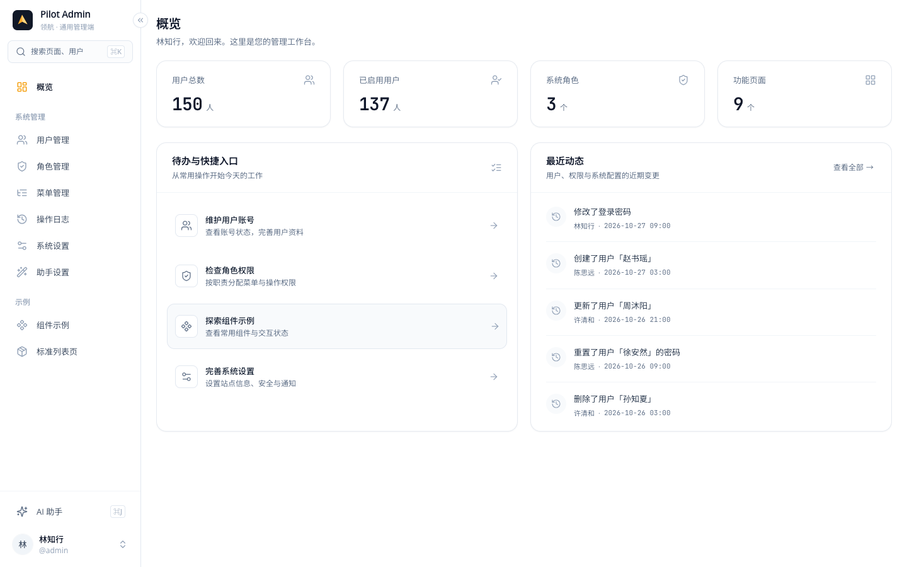
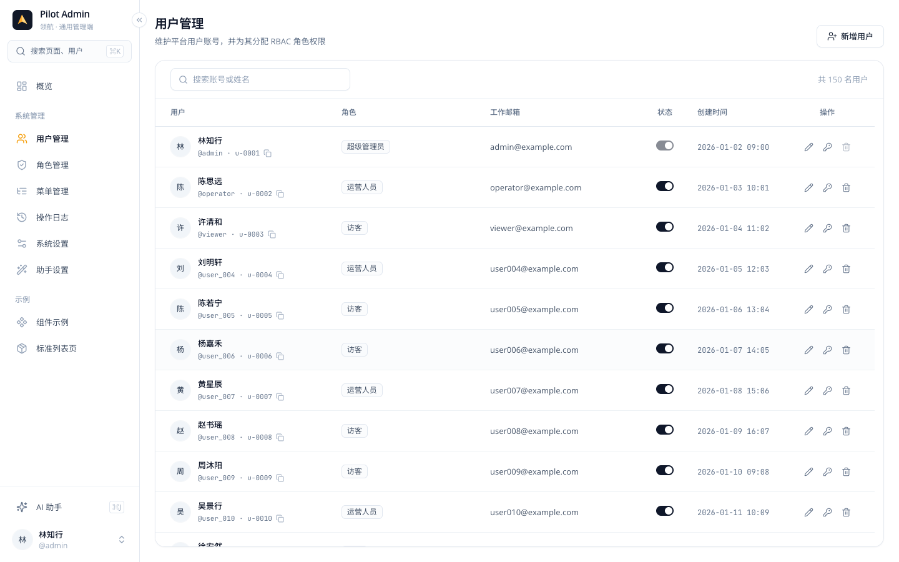
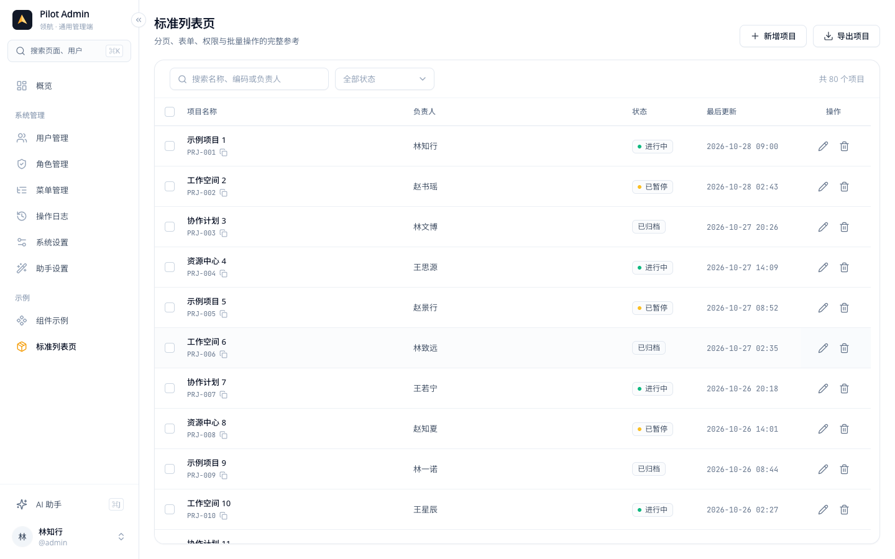
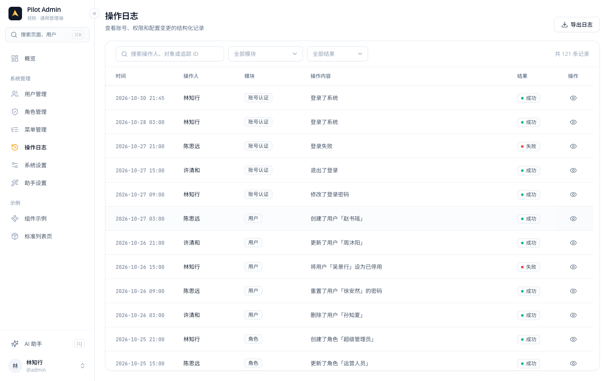
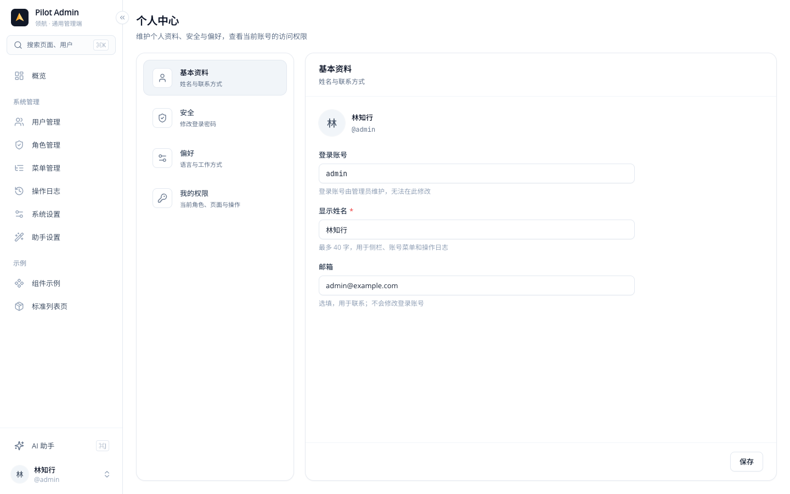
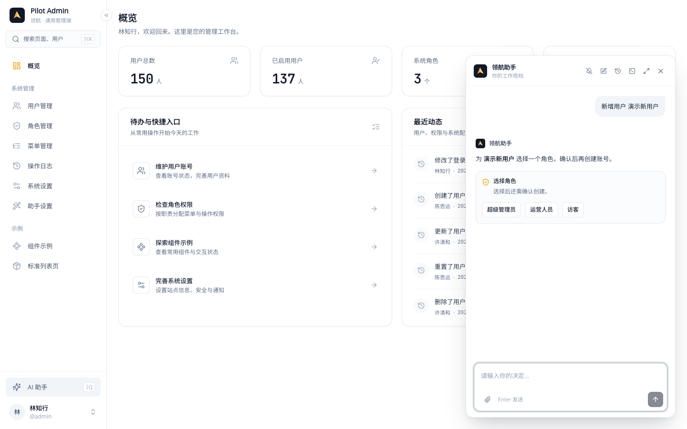
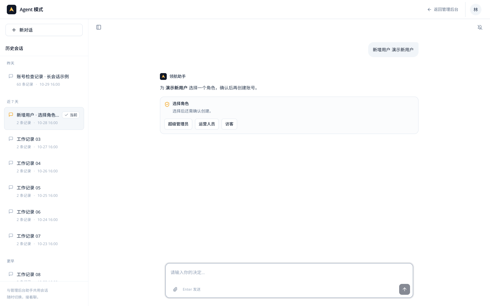

中文 | [English](README.en.md)

# Pilot Admin（领航）

[](https://github.com/kohlarnhin/pilot-admin/actions/workflows/ci.yml)
[](https://github.com/kohlarnhin/pilot-admin/actions/workflows/deploy-pages.yml)
[](LICENSE)
[](https://nodejs.org/)

**[在线演示 →](https://kohlarnhin.github.io/pilot-admin/)** 演示数据保存在访问者的浏览器中，不发送后端请求；演示账号见下方表格。

可直接 fork 的通用 React 管理端起点，包含设计系统、固定侧栏、Mock 登录与 RBAC、管理页面、组件示例、AI 助手面板和全屏 Agent 模式。所有数据和助手执行都在浏览器中完成；默认没有后端请求或真实模型调用。

## 开箱即用

- 紧凑的白色 / slate 设计体系，固定侧栏、独立滚动区域与通用 UI 控件。
- Mock 登录、三种演示角色、菜单与按钮 RBAC，用户 / 角色 / 菜单 / 设置页面。
- 概览、全局搜索、虚拟化无限列表、路由懒加载与悬停预取。
- 共用会话运行时的 AI 助手与 Agent 模式，包含多轮工具、确认卡、计划执行和附件元数据演示。
- 可替换的 service 数据接缝、HTTP / SSE 工具、持久化演示数据及随仓库分发的 UI 规范。
- ESLint、类型检查、构建 CI，以及贡献、安全和双语入门文档。

## 界面预览

1440×900，内置演示数据；更多界面展开查看。

<details>
<summary>界面预览</summary>

**概览**



**用户列表**



**标准列表页**



**操作日志**



**个人中心**



**助手面板**



**Agent 模式**



</details>

## 快速开始

使用 Node 22+ 和 pnpm 10（仓库锁定 pnpm 10.8）。

```sh
pnpm install --frozen-lockfile
pnpm dev
```

打开 http://localhost:3300 。

| 账号 | 密码 | 可用范围 |
| --- | --- | --- |
| admin | admin123 | 全部页面与操作，包括操作日志、助手与模型配置 |
| operator | operator123 | 概览、用户查看/编辑、组件示例、标准列表页新增/编辑与导出、助手；无删除项目、新增/删除用户或操作日志权限 |
| viewer | viewer123 | 概览、组件示例、标准列表页只读与导出；无助手或操作日志权限 |

所有演示账号都有个人中心；标准列表页的默认授权在重置演示数据后生效。

首次登录可选择管理后台或 Agent 模式，并记住选择；在账号菜单的「Agent 模式偏好」中修改。Ctrl/⌘K 搜索页面与用户，最近访问按账号保存；Ctrl/⌘J 打开助手，Esc 先关闭历史再关闭面板。侧栏折叠状态会保留。

演示数据包含 150 位用户、3 个角色和管理员的 25 个历史会话，其中一个会话有 60 条消息。写操作、偏好、草稿和会话均保存在当前浏览器中。同源标签页共享演示 DB；它不是服务端账号系统。

## 目录

```text
src/
  config/             品牌与静态菜单、按钮权限
  ui/                 基础控件与反馈组件
  components/
    layout/ nav/      管理外壳与导航
    common/ search/   通用组件与全局搜索
    assistant/        面板、共享运行时、交互卡和 actions 注册表
  agent/              全屏 Agent、入口和偏好弹窗
  api/
    http.ts           真实后端 Axios 接缝、Token 与 401 刷新
    sse.ts            真实后端流式事件解析器（默认不用）
    services/         唯一数据接缝；当前调用 mock
  mock/
    seed.ts db.ts     确定性数据、v6 存储与重置
    agent/            通用流式引擎、会话与 tools 工具注册表
  hooks/ store/       无限列表、虚拟化、认证、应用和助手状态
  pages/              登录、概览、系统页面、组件示例与错误页
  routes/             页面注册表、访问判断、悬停预取与路由配置
  types/ utils/       通用类型、错误恢复等
tests/                与 src 路径对应的 Node 纯逻辑测试及浏览器 stubs
vitest.config.ts      独立测试配置，不加载应用入口或 Vite 插件
e2e/                  Playwright 真实浏览器旅程与隔离 fixtures
playwright.config.ts  Chromium 根路径 / 子路径生产预览配置
skills/pilot-ui-spec/  可随 fork 复制的 UI 契约、参考资产与实现映射
.github/              CI、Pages/Release 工作流、Dependabot 与双语 Issue/PR 模板
.vscode/extensions.json 编辑器扩展推荐
scripts/release-notes.mjs 按版本提取 CHANGELOG 发布说明
CODE_OF_CONDUCT.md    Contributor Covenant 2.1 与举报入口
CONTRIBUTING.md / CONTRIBUTING.en.md  双语贡献指南
SECURITY.md / CHANGELOG.md / LICENSE  安全边界、版本记录与许可证
```

## 换品牌

1. 修改 `src/config/app.ts` 的 `name`、`shortName`、`zhName` 和 `description`。默认介绍的双语文案在 `src/i18n/locales/zh-CN/common.ts` / `src/i18n/locales/en-US/common.ts` 的 `appDescription`；系统设置保存的自定义介绍保留原文。未配置 `helpUrl` 时，所有「使用手册」入口隐藏。
2. 替换 `src/components/logo/index.tsx` 和 `public/favicon.svg`。本地演示助手资料的默认值在 `src/mock/seed.ts`，运行时默认资料在 `agentProfileService.ts`。
3. 按需修改 `tailwind.config.js` 中的 `brand` 色阶。橙色仅表示品牌、当前位置与进行中，按钮、focus、checkbox 和 switch 保持 slate。
4. 已持久化的站点名称优先于种子。改动默认值后，重置演示数据查看新品牌。

## 添加页面与权限

只需三个步骤，无需修改 `routes/index.tsx`、预取映射或图标路径表：

1. 在 `src/pages/<feature>/index.tsx` 导出页面，复用 PageHeader、Card、FixedTable 和现有 UI。先读 `skills/pilot-ui-spec/SKILL.md` 及相关 references。
2. 在 `src/routes/routeModules.ts` 的 `adminPages` 中添加一个 `definePage`：

   ```ts
   definePage({
     path: '/examples/projects',
     load: () => import('../pages/projects').then((module) => ({ default: module.ProjectsPage })),
   }),
   ```

3. 在 `src/config/menus.ts` 添加菜单（稳定 `id`、相同的 `route_path`、`sort_no`、`icon`）及可选按钮权限，默认名称在两种语言的 `menu` / `button` 字典中按 id 定义。图标直接使用 `src/components/icon/registry.ts` 已注册的 Lucide 名称；不需要另一份路径映射。

注册表在模块作用域创建 lazy 组件；路由、已知页面判断与 hover/focus 预取共用缓存 loader。无路由分组不预取，实际重定向沿用统一的可访问首页选择。

默认 `access: 'menu'` 要求已授权、可见且启用的菜单。额外条件写为 `requires: ['project:manage']`，所有权限都满足才可进入；路由守卫、侧栏、搜索、首页和登录落点使用 `src/routes/access.ts` 的同一个规则。`access: 'authenticated'` 用于不需要菜单的登录后页面，可通过链接进入；例如个人中心 `/profile`。注册项增加 `titleKey: 'profile.title', searchable: true`，即可按本地化标题出现在全局搜索（`titleKey` 只接受无占位符的字典键），无需菜单声明。页面用 `usePermission('project:create')`、`useCan()` 或 `<Access permission={...} fallback={...}>` 控制按钮，service 仍须重新校验权限。`useCan()` / `Access` 支持数组和 `mode="all" | "any"`（默认 all）。`useDataChanged(handler)` 订阅助手写入后的数据变更信号。

详情页只需新增参数路由，授权继承拥有它的静态菜单页面：

```tsx
definePage({
  path: '/examples/crud/:id',
  accessPath: '/examples/crud',
  load: () => import('../pages/examples/crud/ProjectDetailPage')
    .then((module) => ({ default: module.ProjectDetailPage })),
});
```

`accessPath` 必须指向已注册的静态 `access: 'menu'` 页面，开发与测试时会检查。详情自己的 `requires` 也必须满足。`resolvePage(pathname)` 使用 React Router 的 `matchRoutes` 排名：静态路径优先于参数路径，支持尾斜杠和编码片段，不改变 ID 大小写。参数页不单独出现在菜单、搜索或个人权限列表；列表用语义 `Link` 打开详情，并可通过 `state.listSearch` 传回原列表查询串。助手卡片和自动打开也使用相同授权判断，拒绝外部地址。

Mock DB 的权限目录递归覆盖所有层级。种子只有管理员角色设有内部 `auto_grant: true`；新增角色默认为 false。DB 加载及跨标签页存储重载时，auto_grant 角色只获得目录中新出现的菜单/按钮，已手动撤回的旧权限不会恢复；所有角色都会补齐已授权菜单缺失的无路由祖先，不会自动授予有路由的祖先。历史目录只增不减，删除的声明和残留授权不生效，角色计数只统计当前声明。因此新增页面通常无需改角色种子或重置数据；其他角色仍在角色管理中按需授权，角色种子只用于可选的默认授权。真实后端自行决定并校验授权，不依赖这套 Mock 同步。

非路由权限可放在类似 `ai-permissions` 的独立组中。空组不出现在侧栏，但其按钮会进入 me 的权限集合。`/agent` 通过 `agent:use` 守卫，助手设置同时需要页面菜单与 `agent-config:view`。已持久化的菜单自定义名称始终优先于默认名称。

## 添加 service 与 Mock

页面只从 `src/api/services/*` 获取数据，不直接访问 DB。新增实体时：

1. 在 `src/types/index.ts` 定义类型，在 `src/mock/seed.ts` 添加确定性种子。
2. 在 `db.ts` 补充完整形状校验。新增集合或改变持久化结构时，提升 `MOCK_DB_VERSION`、`MockDb.version` 和种子版本，并在 `src/mock/migrations.ts` 按旧版本号添加迁移（如键 `5` 表示 v5 → v6）；每一步都返回下一版本的数据，不靠升版重置用户数据。
3. service 使用 `delay()`、`response()`、`pageResult()`，返回 `ApiResponse<T>` 或 `PageResult<T>`。分页字段为 `records / pageNo / pageSize / total / hasNext`。
4. 使用 `updateMockDb()` 持久化，存储失败会抛错。不要在页面重复实现延迟、分页或权限。
5. 大列表接 `useInfinitePage` 与 `FixedTable`，保留每页 20 条、静默追加、ID 去重、代次隔离和显式重试；不增加页码分页。

迁移函数必须纯且确定：不读取时钟、随机数、语言或存储，不调用 `createId()`、`Date.now()`、`t()`；新增 ID、日期和文本从旧数据或固定锚点派生。`src/mock/dbStorage.ts` 注入 Storage、迁移、校验、种子与目录同步：优先读有效当前键；否则取支持范围内最高的旧键，依次迁移，完整校验，补齐权限目录并再次校验，再写当前键。用旧版本 fixture 测试账号、角色、会话、项目和审计均保留，并测试迁移失败、写入失败、并发迁移和未来版本键。

迁移或首次回退的这一轮保留源键；仅下次启动已存在有效当前键时才清理低版本键。迁移异常、缺少迁移或结果无效会回退种子，源键在本轮不动；写入失败保留迁移后的内存数据。当前版本为 v6，迁移起点为 v5；首个 v5 → v6 迁移保留全部集合，添加空的 `importReceipts`。更早或损坏的数据仍回退种子。

只要检测到更高版本键，旧页面仍可读取自己的数据，但不再写入或重置，返回业务码 `40990` 和「数据已由新版本页面升级，请刷新本页」。移除测试用未来键后也需刷新才能继续。已有、未包含此保护的旧部署无法被新页面约束；升级期间应关闭或刷新这些旧标签页。未来版本键始终不删除。M9a（DB v5）标签页检测到 v6 后进入只读；刷新即可使用新构建，不能从旧页面继续写入新审计动作。

`createUser()` 统一生成默认 10 位随机密码并返回 `initial_password`。若密码策略要求更长，则使用策略长度。页面只在创建成功弹窗中展示和复制；查询接口不返回密码。助手新增用户使用同一接口，并在本次创建回复中显示账号和初始密码；该回复随会话保留。

## 接真实后端

逐个替换 `src/api/services/*` 的函数体，页面和 UI 不需要依赖 Mock：

```ts
const response = await http.get<ApiResponse<PageResult<User>>>('/users', { params });
return response.data;
```

`src/api/http.ts` 默认 baseURL 为 `/api`，附加 access token；401 用 refresh token 单飞刷新，并兼顾跨标签页轮换与未授权退出。`authService` 的 login/getMe/changePassword/patchPreferences 应改为服务端接口，返回现有类型。`authStore` 继续负责 initAuth、generation 隔离、me 刷新与 logout；`tokenStorage.ts` 负责持久化及跨标签页会话变化。真实后端必须自行执行 RBAC；Mock token 只用于本地演示。

Mock 与页面从轻量的 `src/api/errors.ts` 引用错误类型；真实 service 引入 `src/api/http.ts` 时才会加载 Axios，原有错误类型导入仍兼容。

在 `agentService.ts` 中将 `chatStream` / `continuePlan` 改为 `runSseStream<AgentChatResult>()`，其余会话与计划方法改用 http。`sse.ts` 默认未被运行时使用，不会发起请求。

```ts
return runSseStream<AgentChatResult>('/api/agent/chat', payload, {
  onStart, onDelta, onProgress, signal,
});
```

SSE 使用 UTF-8、POST JSON、`Authorization: Bearer …`；支持一次 401 刷新重试。每个事件由空行结束，data 可跨行：

```text
event: start
data: {"sessionId":"s1","userMessageId":"m1"}

event: delta
data: {"content":"正在整理"}

event: progress
data: {"stage":"checking","message":"正在检查账号…","elapsedSeconds":1}

event: result
data: {"code":0,"message":"success","data":{"sessionId":"s1","messageId":"m2","message":"完成","data_changed":false,"choices":[]}}

```

错误用 `event: error` 和 `{"code":123,"message":"可读错误"}`。兼容源协议的 `done` 终态别名；缺少结果的断流视为错误。配置超时或 AbortSignal 会取消 reader。真实 agentService 在 `data_changed` 后调用 `triggerDataChangeSideEffects()`，通知概览和用户页刷新。模型配置的 API key 由真实后端保存密文，列表只返回掩码；当前演示配置只保存在浏览器且从不调用。

## 新增助手能力

每个工具是 `src/mock/agent/tools/` 中的独立模块，实现 `types.ts` 的 `AgentTool`，在 `index.ts` 的有序 `agentTools` 注册表中加入；fallback 始终最后。新增多轮工具无需修改 `engine.ts`。以 `createUser.ts` 为完整参考：

1. 在两种语言的 `agentCommands.ts` 增加同名命令及 `primary` / `alternate` 触发短语；`src/agent/commands.ts` 自动纳入联合目录。带参数且仅应在开头触发的**前缀命令**（如新增用户）还须加入该文件的 `prefixCommands`；帮助、统计等**非前缀命令**可在句中匹配，不加入此集合。`match` 和参数截取都使用 `parseCommand(text, commandId)`。`handle(ctx)` 校验权限并返回角色 choices，同时用 `task: { name }` 保存下一轮所需状态。
2. 引擎将工具 ID 和状态保存在消息的 `task_context: { tool, data }` 中。点击选项时，自动调用该工具的 `onChoice(ctx, choiceId, task)`，不再按输入文字猜测工具。
3. `onChoice` 处理角色选择，返回确认 choices 和新的 `task: { name, roleId }`；确认后通过 `userService` 创建账号并返回 Markdown。每轮继续校验权限，修改成功后调用 `triggerDataChangeSideEffects()`，让已打开页面刷新。

```ts
import { parseCommand } from '@/agent/commands';
import { t } from '@/i18n';

// 新命令须先在两种语言的 agentCommands / agentTools 字典中注册。
export const myTool: AgentTool = {
  id: 'my-tool',
  match: text => parseCommand(text, 'myTask').matched,
  handle: async ctx => ({
    message: t('agentTools.myTask.confirm'),
    choices: [{ id: 'next', label: t('common.actions.confirm') }],
    task: { argument: parseCommand(ctx.text, 'myTask').argument },
  }),
  onChoice: async (ctx, choiceId, task) => {
    ctx.signal?.throwIfAborted();
    return { message: t('agentTools.myTask.result', { choice: choiceId, argument: String(task.data.argument) }) };
  },
};
```

解析器接受两种语言全部短语，不受当前语言影响；Latin 命令忽略大小写，兼容首尾及词间空白。前缀命令只在开头匹配，边界为文本结束、空白、冒号，或中文短语后直接跟 CJK 参数；`create username` 不会误命中 `create user`。帮助、统计、巡检等原有非前缀入口也通过同一目录匹配。命令短语是解析数据，与展示标签分开维护；`commandPrompt` 生成当前语言命令，`prompt:*` 提交会本地化命令但保留原 choice ID 和参数。打开页面支持当前自定义菜单名、两种默认名称与路由路径。

例如新增 `createWidget` 命令，英文短语为 `create widget`：将 ID 加入 `prefixCommands` 后，`parseCommand('Create widget Alice', 'createWidget')` 返回 `{ matched: true, argument: 'Alice' }`；`create widgetname`（缺少边界）和 `please create widget Alice`（不在开头）均不匹配。

`ctx` 含当前用户 ID、菜单、权限、AbortSignal 和附件元数据。可选 hooks 还包括 `onSelection(ctx, selectedIds, task)`（参考 `disableUsers.ts`）与 `onActionOutcome(ctx, outcome, task)`（参考 `assignRoles.ts`）。通用 `prompt:*` choices 会重新匹配注册表，`cancel` 由引擎取消；其他 choice ID 交给工具。只接受最新且未提交的交互，选择数量与选项 ID 由引擎校验，具体操作仍由 service 重新校验。

计划工具参考 `accountAudit.ts`：首轮返回 `execution_plan` 卡片，工具的 `plan.runStep(ctx, plan, stepIndex, task)` 负责每一步读取、计算和最终报告，返回 `ToolReply`。若返回 `task`，引擎会更新原计划的状态数据，供下一步或继续执行时使用。引擎统一管理 executionId、步骤状态、持久化和停止语义；「停止」让当前步骤完成，其余步骤停止，「继续执行」使用新 executionId 跳过已完成步骤。工具处理耗时工作时应检查 `ctx.signal`。

内置工具还包括帮助、概况统计、查找用户、打开页面、模拟错误、附件元数据与 fallback。所有读写均通过 service；operator 新增用户会被拒绝，确认不会提升权限。弹窗工具配合下方的**客户端操作注册表**，工具 hook 负责结果续话，弹窗负责交互和 service 调用。

附件规则：仅接收名称、大小、MIME 类型和可选行数。`.txt/.csv/.json` 的行数在浏览器局部计算；不把文件正文、原始文件或解析内容放进消息、持久层或网络。默认最大 5 MB。

## 添加助手弹窗操作

1. 在 `src/components/assistant/actions/` 创建组件，接收 `AssistantActionProps` 的 `onComplete(outcome)` 和 `onCancel()`。
2. 调用 `registerAssistantAction('feature.action', Component)`，并在 `PageActionCard.tsx` 的模块入口引入注册模块。
3. 工具返回 `interaction: { type: 'page_action', version: 1, action: 'modal', actionKey: 'feature.action', title, description }`。
4. 弹窗通过 service 执行业务，完成后 `await onComplete({ status: 'completed', summary, count })`；取消走 `onCancel`。PageActionCard 统一调用 `recordPageActionOutcome`，保存卡片终态并在原会话续上摘要。保存失败可重试，不能重复执行已成功的写入。

内置 `users.assign-role` 演示用户分页选择、角色替换、部分成功后重试与取消。面板和 `/agent` 只有一个 AssistantRuntime；不要在新页面另建聊天实例。执行计划的「停止」等待当前步骤完成，「停止生成」取消当前流。

## 重置与存储边界

系统设置 → 演示数据 →「重置演示数据」恢复所有种子，包含 150 用户、3 角色、模型资料和 25 个管理员历史会话，清理助手草稿/对话缓存并重新载入。也可从 service 调用 `settingsService.resetDemoData()`，内部使用 `resetMockDb()`。

DB key 为 `pilot-admin:mock-db:v6`，迁移起点为 v5；v4 及更早数据不在迁移范围，仍回退种子。源键保留及旧标签页写入保护见[迁移说明](#添加-service-与-mock)。每个用户最多保留 60 个会话、每会话 200 条消息；每条正文最多 16000 字符，本地最近对话缓存最多 100 条。附件不缓存正文。浏览器完成通知按用户选择启用，仅对实时完成事件触发；历史恢复不会重复通知。

## 环境变量

默认不需要 `.env` 文件。需要配置真实后端接缝时，可将 `.env.example` 复制为 `.env.local`；`.env*` 文件被 Git 忽略，仅提交 `.env.example`。

| 变量 | 默认值 | 用途 |
| --- | --- | --- |
| `VITE_BASE_PATH` | `/` | 页面与静态资源的部署前缀，例如 `/pilot-admin/`；自动补齐首尾 `/`，不接受域名或完整 URL |
| `VITE_API_BASE_URL` | `/api` | HTTP 两个 Axios 实例及 SSE 相对路径的基础地址，可设根路径或完整 HTTP(S) URL |
| `VITE_DEV_PROXY_TARGET` | 空 | 仅开发服务使用的代理目标，留空不启用代理 |

代理按 API base 的路径部分匹配同源请求，保留路径前缀，设置 `changeOrigin: true`，不代理 WebSocket。例如 base 为 `/api`、target 为 `http://localhost:8080` 时，`/api/users` 转发到 `http://localhost:8080/api/users`。完整 API URL 会直接访问对应地址，不经过开发代理。`pnpm preview` 不启用代理，默认 Mock 流程也不会因为配置了变量而自动调用后端。

HTTP 调用中的 `/users` 由 Axios 结合 API base。SSE 的 `agent/chat`、`./agent/chat` 使用 API base；以 `/` 开头的路径和完整 URL 按原值请求，因此现有 `/api/agent/chat` 不会重复加前缀。需要跟随自定义 base 时，使用无前导斜杠的 SSE 路径。

`VITE_*` 变量可被客户端读取，不得填写密码、Token 或模型密钥。修改环境变量后需重启开发服务；生产配置在构建时生效。

## 部署

### 静态托管与子路径

默认构建部署在站点根路径，`dist/` 是完整静态产物：

```sh
pnpm build
pnpm preview --port 3300
```

部署到 `/pilot-admin/` 等子路径时，在构建前设置前缀，也可写入 `.env.local`：

```sh
VITE_BASE_PATH=/pilot-admin/ pnpm build
pnpm preview --port 3300
```

此时预览地址为 http://localhost:3300/pilot-admin/ 。Vite 会调整 HTML、favicon、字体、CSS 和 JS 分包资源地址，Router 使用同一 basename；页面注册和 `navigate('/profile')` 等内部导航继续使用不带部署前缀的路由。前缀只接受路径，禁止 scheme、host、查询、fragment、空白、反斜杠及 `.` / `..` 路径段；修改前缀后须重新构建。

静态服务器需把 `dist/` 内容挂载到构建前缀对应的 URL 目录。对不存在的**页面导航路径**回退到该目录的 `index.html`；`assets/` 下缺失的资源应返回真实 404，不能返回 HTML。哈希资源可用 `Cache-Control: public, max-age=31536000, immutable`，`index.html` 用 `Cache-Control: no-cache`，避免部署后继续引用旧分包。默认演示只读取本地数据，不需要 API 代理。

localStorage 按 origin 共享，而不是按部署路径隔离。项目键均带 `pilot-admin:` 前缀，不清空其他应用的存储；同一域名下的多个 Pilot Admin 副本仍共享这些键，需要隔离时应在 fork 中统一更换命名空间或使用不同域名。

### GitHub Pages

仓库已包含 `.github/workflows/deploy-pages.yml`：推送 `main` 或手动运行时，执行冻结安装、lint、i18n、类型检查和构建，再上传并部署 `dist/`。仓库需在 **Settings → Pages → Build and deployment → Source** 选择 **GitHub Actions**；本仓库已完成该设置。工作流按仓库名称使用 `/<repository-name>/`，适用于项目站点；用户/组织根站点或自定义根域名部署时，把工作流的 `VITE_BASE_PATH` 改为 `/`。

工作流将 `index.html` 复制成 `404.html`，使 `/pilot-admin/system/users` 等深链刷新后仍可启动应用。**GitHub Pages 对此返回 HTTP 404 状态，而非 200**；这是该托管方式的行为，不能把它当作支持服务器重写的 SPA fallback。普通静态主机应优先配置导航重写。

### 发布静态产物

先同步 `package.json` 版本和 CHANGELOG 对应的 `## [X.Y.Z]` 章节并提交，再创建并推送版本标签：

```sh
git tag vX.Y.Z
git push origin vX.Y.Z
```

Release 工作流会校验标签必须等于 `v` 加包版本，执行工程检查，以 `/` 为前缀构建，并发布 `pilot-admin-vX.Y.Z-dist.zip`。发布说明由 `node scripts/release-notes.mjs X.Y.Z` 提取；章节缺失或为空时发布失败。源码仍保持 `private: true`，不发布 npm 包。Fork 后请同步修改仓库、演示和徽章链接。

## 国际化

默认语言为 `zh-CN`，不读取浏览器语言。登录页右上角与账号菜单的「语言」入口可切换简体中文 / English，无需刷新页面；选择保存在 `pilot-admin:locale:v1`，同源标签页跟随切换。`src/config/app.ts` 配置默认语言和原生语言名称。

- 字典按功能存放在 `src/i18n/locales/zh-CN/<namespace>.ts`，以中文 literal 为源，导出 `as const` 对象；`en-US` 对应文件使用 `LocalizedDictionary<typeof source>` 校验。新增 namespace 后在两种语言的 `index.ts` 注册，缺失或多余 key 会导致类型错误。
- key 按语义命名，并按列、表单、提示或对话框等用途嵌套分组，如 `users.toast.created`、`users.deleteDialog.content`；不要从句子截取键名。每段使用 camelCase（`/^[a-z][a-zA-Z0-9]*$/`），最多 24 个字符。相同的通用文案复用 `common`（如 `common.actions.retry`、`common.toast.saveFailed`），仅在措辞确有差异时保留功能专用 key；服务错误归入 `serverErrors`，审计动作句子归入 `audit`。
- React 渲染使用 `const { t, locale } = useT()`；service、store 和事件处理可调用非 hook 的 `t()`，每次调用读取当前语言。静态 METRICS / SECTIONS 等只存 `MessageKey`，在订阅语言的渲染处翻译；翻译后的列定义、格式化器等 memo 必须依赖 `locale`。

  ```tsx
  const { t } = useT();
  t('auth.login');
  t('auth.loginTitle', { name: 'My Admin' });
  // 未知 key、遗漏 name、错误参数名或为无参数 key 传参都会报类型错误。
  ```

- `{name}` 插值参数从中文 literal 推导，值为 string / number。运行时按当前语言 → 中文 → key 回退；开发环境缺少参数会保留占位符并警告。`formatNumber` 使用当前语言，dayjs 随语言切换；已有明确的日期格式保持不变。
- 不引入复数引擎。英文优先使用不依赖单复数的表达，如 `Users: {count}`，避免在数量可能为 1 时固定使用复数名词。
- 默认菜单与按钮名称在 `mockMenus()` 请求时按 `menu.<camelCaseId>` / `button.<camelCaseId>` 本地化（如 `user-reset-password` 对应 `button.userResetPassword`，权限 ID 不变），重命名覆盖在两种语言下都保留；HTTP 与 SSE 传 `Accept-Language`。概览待办返回稳定 code，页面在渲染时翻译；真实后端可按同一边界返回代码或已本地化错误。
- 切换会更新 html lang / dayjs、清查询缓存、刷新已登录账号的 me，并通过 `useDataChanged` 发出 `locale` 原因。无限列表将 locale 纳入作用域，丢弃旧语言响应，刷新已加载范围并尽量保留滚动位置。路由、助手面板、草稿和已存会话不变；已打开的命令式弹窗 / toast 保留打开时语言。
- 外壳、管理页面、助手 / Agent 界面、全部 Mock 工具及演示种子已支持双语。服务错误在返回时使用当前语言，审计动作存为稳定代码，在渲染时翻译；用户输入、已存用户/角色名称和会话不随切换重译。
- 种子文案以单独的 `seedText` 导出保存在 `src/i18n/locales/<locale>/seed.ts`，共享 `src/i18n/seed.ts` 的 `SeedText` 接口，不加入 `t()` 消息树，支持姓名数组。首次创建或重置演示数据时按当前语言生成角色、用户姓名、站点介绍、模型显示名称和示例项目；ID、登录名、邮箱及确定性顺序保持一致，当前为 DB v6。助手资料及 25 个历史会话也按种子创建时的语言生成，长会话仍有 60 条消息。
- 工具回复、choices、计划与操作卡在回复生成时采用当前语言并存入消息；切换不会重译旧消息、旧卡片标签或计划标题，choice ID、task context、executionId 和状态始终是代码。默认助手资料在读取时随当前语言变化；显式保存后通过 Mock 内部的可选 `agentProfileCustomized` 标记保留为数据（含保存后与默认文字相同的资料），未标记的默认资料仅在精确匹配已知种子时视为未自定义。
- 在角色权限弹窗切换语言时，重新读取菜单/按钮名称并保留当前勾选；菜单重命名保留输入中的名称，系统设置保留未保存字段。已经持久化的自定义名称在两种语言下都优先于默认名称。

运行 `pnpm i18n:check` 检查 key 每段的 camelCase 命名与 24 字符上限、两种语言的 key / 占位符一致性，以及源代码中的 CJK 字符串、模板、JSX 与正则。注释不参与检查；`scripts/i18n-allowlist.json` 仅接受带原因的文件 + 原文精确例外，`scripts/i18n-pending.json` 已清空为 `[]`，保留机制供分阶段迁移使用。过时例外和已无 CJK 的 pending 条目会使检查失败，不能靠扩大豁免绕过迁移。

## 操作日志

`src/types/index.ts` 的 `AuditLog` 使用稳定 `module` / `action` / `result` / `reason` 代码、操作人与目标的写入时显示名以及追踪 ID。`src/audit/catalog.ts` 定义完整动作与参数白名单；不记录密码、密码 hash、Token、API Key 或原始错误。业务校验与权限拒绝由 `recordAuditFailure` 按状态码记录失败原因；不保存原始错误，审计保存失败不覆盖原业务错误。登录失败单独记录，退出记录失败不阻止本地清理；持久化失败不再尝试第二次审计写入。

新增写服务时，把日志追加到业务的同一个 draft，生成一次追踪 ID，并让响应复用它：

```ts
const traceId = createTraceId();
updateMockDb((db) => {
  const user = db.users.find((item) => item.id === userId)!;
  user.status = status;
  recordAudit(db, {
    actor,
    action: 'user.status',
    target_type: 'user',
    target_id: user.id,
    target_name: user.user_name,
    params: { status },
    traceId,
  });
});
return response(undefined, traceId);
```

`recordAudit` 位于 `src/mock/audit.ts`，只修改传入的 draft，不另写 DB；完整服务实现可参考 `userService`。返回 `void` 或 Token 的既有接口保留签名，内部仍生成追踪 ID。个人资料和账号偏好保存记作 `profile.update`，目标为当前用户；`params.fields` 只存字段名 `user_name`、`email`、`agent_mode_entry`，按此目录顺序去重，渲染时翻译并按当前语言连接，不保存字段值。`settings.update` 的分类仅为 `basic`、`security`、`notifications`。助手工具复用写服务，不重复记日志。演示重置在同一次保存中放入新种子和 `settings.reset_demo`。

扩展动作时同步更新 `AuditParamsMap`、运行时 `AUDIT_PARAMS` 白名单、两种语言 `audit.ts` 和 `src/audit/format.ts` 映射。存储代码保留 snake_case；字典段使用 camelCase，例如 `auth.login_failed` 对应 `audit.action.auth.loginFailed`。翻译在页面渲染或导出时发生，语言切换会更新已存日志的句子；显示名仍保留写入时的数据。偏好、计数和状态只保存代码，不保存翻译文案。

系统管理 → 操作日志支持关键词、模块、结果组合筛选、无限追加、虚拟化、详情抽屉和追踪 ID 复制。关键词匹配操作人、目标、操作代码和追踪 ID。列表/计数要求该菜单，导出额外要求 `audit-log:export`；内置管理员具备，操作员和访客不具备。概览只拿最近 5 条成功记录的受限投影，排除 `auth.login` 和 `auth.logout` 会话事件，不包含操作人/目标 ID、追踪 ID、失败原因或任意原始参数；每行以操作句子为主行、操作人与时间为元信息，只有可访问日志页的账号看到「查看全部」。

DB v5 一次性引入 `auditLogs`（最新在前，上限 1000）与 `exampleProjects`（80 条确定性种子），移除 `activities`。v4 及更早数据首次升级会重置演示数据一次；当前模板使用 v6，并从 v5 保留数据迁移。初始审计记录为固定锚点前 30 天的 120 条历史示例。

CSV 使用 `src/utils/csv.ts`：UTF-8 BOM、全部字段加引号、双引号转义、CRLF 行尾。以 `=`、`+`、`-`、`@`、Tab、CR 开头（含前导空白）的单元格加 `'` 前缀，供电子表格按文本打开；该安全转换也会作用于显示名。导出当前筛选结果，服务最多返回 5000 条（当前存储上限 1000）。

## 从模板开始一个新模块

示例 → 标准列表页（`/examples/crud`）是完整的 CRUD 参考：分页与虚拟化、组合筛选、内联校验、单条/批量删除和安全 CSV。导出有意只要求页面访问，访客也可导出；需要独立导出权限时参考操作日志页。管理员自动取得新菜单/按钮；已有本地 v5 数据不改写其他角色的授权，运营（新增/编辑）与访客（只读）的默认菜单需在「重置演示数据」后出现。模板使用 DB v6，v5 数据自动迁移，不重置已有数据。

点击项目名称进入 `/examples/crud/:id`：元数据、可复制编码、最多 1000 字的描述和生命周期历史分别展示。描述与分页虚拟历史独立滚动，短视口改为整列滚动；运营可编辑、管理员可删除，访客只读。历史只返回该记录的安全展示投影，不要求操作日志菜单权限。已有记录的正文不变，前 5 个多段示例只用于首次创建或重置的数据。

CSV 导入是可删除的参考流程：`ProjectImportModal.tsx` 负责本地文件状态、双栏预览与结果；`projectImport.ts` 负责表头映射、预检和每批 25 行的顺序调度；`src/utils/csvImport.ts` 提供纯解码/解析；`exampleProjectRules.ts` 共享字段规则；service 的 `importProjects` / `getImportStatus` 与 `src/mock/importReceipts.ts` 提供原子提交、对账和回执裁剪。fork 不需要导入时，可移除前两个文件及列表入口，再移除对应服务方法、规则外的导入类型/回执集合/审计与文案；普通 CRUD 仍可单独使用。规则模块也供普通新增/编辑服务使用，应保留。

导入只接受逗号 CSV，最多 1 MB / 500 条非空逻辑记录（引号内换行不增加条数）。严格 UTF-8（可带 BOM）失败后尝试 GB18030，并显示编码；可重新解码相同字节。支持首行 `sep=,`；重复列、未知列、缺少 `name,code,owner,status` 为文件错误，`description` 可选，列顺序不限。模板和失败行下载使用稳定机器列名及 `active/paused/archived`；失败行额外包含 `reason`，须修正原因并移除该列后再导入。普通导出保留本地化列名/状态，不能作为导入模板。

预览区虚拟化，原文只显示前 200 行或 20,000 字符。无效行在本地跳过；服务再次校验有效行与 DB 编码冲突。每次调用只写一次 DB，项目、逐行回执和 `example.import` 审计原子提交；审计 `{ count, failed }` 仅统计本次新创建/拒绝的行，重放回执不重复计数；整批都是重放时不写审计。续传先查询同一 `importId` 的回执，再发送未处理行；权限和 stale-build 错误终止，连接/存储错误保留结果并显式继续。回执只存 ID、行号、状态、错误码、操作者与日期，保留最近 20 个导入且最多 5000 行；幂等恢复限于回执仍保留的期间。文件字节、原文与解析行只在弹窗内存中，关闭后释放，不进入助手、请求层或持久化预览。

所有下载继续通过 `toCsv` 防公式执行。导入不执行公式，也不去掉用户已有的前导单引号；因此公式前缀值经过下载添加安全单引号后，不保证完全原样往返。落库沿用普通 CRUD 的名称/负责人/描述首尾空白规范化。

按下面顺序复制，避免只复制页面却遗漏服务、类型或权限。以 `Widget` 为例，统一替换 `ExampleProject` → `Widget`、`ExampleProjectStatus` → `WidgetStatus`、`exampleProjects` → `widgets`、`exampleProjectService` → `widgetService`、`ProjectInput/ProjectFilters` → `WidgetInput/WidgetFilters`、`PROJECT_CODE_EXISTS` → `WIDGET_CODE_EXISTS`、`example:*` → `widget:*`、`example.*` → `widget.*`、`/examples/crud` → `/examples/widgets`；菜单 ID `crud-example` → `widgets`、按钮 ID `example-*` → `widget-*`，字典键相应改为 `menu.widgets` / `button.widgetCreate|Update|Delete`。

1. **类型**：在 `src/types/index.ts` 复制 `ExampleProject` / `ExampleProjectStatus`，保留 `AuditFields`；按实际字段修改。
2. **Mock 集合**：在 `src/mock/seed.ts` 复制别名 `MockExampleProject`、`MockDb.exampleProjects` 与 80 行种子生成/返回代码；在两种语言的 `seed.ts` 及 `src/i18n/seed.ts` 增加对应种子文本。在 `src/mock/db.ts` 的 `isMockDb` 加入集合数组和逐行形状校验。新增持久化集合/形状时同步提升 `MOCK_DB_VERSION` 与 `MockDb.version`/`createSeed().version`，按[迁移说明](#添加-service-与-mock)添加纯迁移和旧数据保留测试；使用现有模板集合无需提升版本。
3. **审计目录**：在 `src/types/index.ts` 扩展 `AuditModule`、`AuditParamsMap`、`AuditLog.target_type`；在 `src/audit/catalog.ts` 增加模块与动作白名单（批量删除仅 `{ count }`），在 `src/mock/db.ts` 扩展目标类型校验，在 `src/audit/format.ts` 增加动作/模块/目标映射。两种语言 `audit.ts` 增加句子、模块及目标名称。在 `src/mock/auditSeed.ts` 的模块目标映射中增加新模块目标（该表覆盖所有 `AuditModule`）；若不需要历史演示记录，在动作筛选中排除新模块。不要把原始输入或错误放入日志。
4. **服务**：复制 `src/api/services/exampleProjectService.ts` 与 `exampleProjectRules.ts` 为对应 widget 文件，替换集合、类型、路由、权限、审计代码和业务错误常量。两种语言 `serverErrors.ts` 增加 `widget` 分组；保留服务校验、数字重复码、同 draft 审计、失败不覆盖原错，以及批量先验证后一次提交的逻辑。
5. **页面**：复制整个 `src/pages/examples/crud/` 为 `src/pages/examples/widgets/`，重命名 `ProjectFormModal`、`ProjectDetailPage`、`ProjectHistory` 和 `CrudExamplePage` 的文件、导出与 import，按上面的映射替换类型/服务/权限/字典及列表/详情路径；定制列、筛选、表单规则与 CSV 字段。详情的 `accessPath` 指向新列表，历史使用服务投影而非直接读取日志。`// 模板：…` 标出了需要按产品取舍的位置。页面保持只调用服务。
6. **文案**：复制两种语言的 `exampleProjects.ts` 为 `widgets.ts`，英文的 source import 也要改名，并在两种语言 `index.ts` 注册；在 `menu.ts` / `button.ts` 添加菜单和按钮键。保留语义 camelCase 命名及占位符一致性。
7. **注册与授权**：在 `src/routes/routeModules.ts` 增加一个 `definePage`（新的路径、文件与导出名）；在 `src/config/menus.ts` 增加一个菜单项及 create/update/delete 按钮。图标从现有 registry 选择。Mock 的 `auto_grant` 角色会自动取得新权限；如需其他默认角色，在 `src/mock/seed.ts` 配置其菜单/按钮 ID，并重置演示数据验证。真实后端决定实际授权。
8. **验证**：运行 `pnpm lint`、`pnpm i18n:check`、`pnpm typecheck`、`pnpm test`、`pnpm build`。用三角色与双语检查 1280×720 / 1440×900，覆盖重复编码、批量失败、分页、选择与语言切换、导出和审计；确认新集合刷新后仍存在。

## 个人中心

所有已登录账号（包括访客）都可从账号菜单第一项或全局搜索进入 `/profile`，无需分配菜单权限。Agent 顶栏的入口也会进入管理后台的个人中心。

- **基本资料**：维护显示姓名（必填，最多 40 字）和可选邮箱，登录账号只读。`profileService.updateProfile` 只更新当前用户，忽略额外字段；成功后 `refreshMe()` 更新侧栏与账号菜单。语言和分类切换保留未保存输入。
- **安全**：与快捷修改密码弹窗共用 `PasswordChangeForm`，字段错误内联显示；修改成功后退出登录，使用新密码重新登录。
- **偏好**：语言与账号菜单使用相同的即时切换机制；有 `agent:use` 时可设置 Agent 入口，与偏好弹窗共用提交逻辑。
- **我的权限**：只读展示当前有效角色、可访问页面树和按模块分组的操作名称/代码，包含不在侧栏显示的助手权限。访客显示无操作权限状态。

资料保存与 `profile.update` 审计在同一 draft 中提交，`params.fields` 只记录实际改变的 `user_name` / `email` 字段名；无变化时不写 DB、不记审计。资料字段沿用原有结构，无需重置演示数据。

## 脚本与验证

| 命令 | 用途 |
| --- | --- |
| `pnpm dev` | 0.0.0.0:3300 开发服务，不自动打开浏览器，默认无代理 |
| `pnpm lint` | ESLint 检查，须 0 error / 0 warning（`--max-warnings 0`） |
| `pnpm i18n:check` | 字典 / 占位符一致性和源代码 CJK 门禁 |
| `pnpm typecheck` | TypeScript strict 检查 |
| `pnpm test` | Vitest 纯逻辑单元测试（单次运行） |
| `pnpm test:watch` | 监听变更并重跑测试 |
| `pnpm exec playwright install chromium` | 首次安装 E2E 使用的 Chromium |
| `pnpm test:e2e` | 自动构建并启动 3320 / 3321 生产预览（可用 `E2E_PORT` / `E2E_SUBPATH_PORT` 覆盖），运行真实浏览器回归 |
| `pnpm test:e2e:ui` | Playwright UI 调试，可选择测试与查看步骤 |
| `pnpm build` | `tsc -b && vite build` |
| `pnpm preview` | 本地预览生产构建，可加 `--port 3300` |

提交前跑 `pnpm install --frozen-lockfile && pnpm lint && pnpm i18n:check && pnpm typecheck && pnpm test && pnpm build`。根目录 `tests/` 使用 Node 环境和最小浏览器 stubs，覆盖命令、权限目录、页面访问、CSV、SSE、国际化、Mock DB 与分页；测试隔离和单例导入方式见[贡献指南](CONTRIBUTING.md#验证与交付)。UI 改动必须启动真实页面，在 1280×720 和 1440×900 操作并检查滚动、三种角色权限、焦点与错误恢复；生产预览不应发送外部或后端请求。项目内 AI 工作约定见 AGENTS.md，视觉契约见 `skills/pilot-ui-spec/`。

E2E 覆盖登录、角色权限、导航、用户、标准列表 CRUD/CSV、助手计划与共享会话、英语持久化、数据重置和 `/pilot-admin/` 子路径；每个测试独立初始化浏览器存储。首次安装 Chromium 后，运行 `pnpm test:e2e` 即可，无需手动启动服务。CI 在工程检查通过后自动运行，包括 fork PR。调试与 trace 用法见 [贡献指南](CONTRIBUTING.md#浏览器端到端测试)。

## 路线图

- CSV 导入、逐批进度、幂等重试与失败行下载。
- 左树右表目录示例、带历史面板的行内编辑工作台。
- 助手/示例模块开关与经过实际删除验证的裁剪指南。
- 持续改进无障碍、性能与开发文档。

## 参与贡献

开发流程、提交规范和验证要求见 [中文贡献指南](CONTRIBUTING.md) / [English](CONTRIBUTING.en.md)，参与须遵守 [行为准则](CODE_OF_CONDUCT.md)。安全问题按 [SECURITY.md](SECURITY.md) 仅申请私下联系，不在公开 Issue 附漏洞细节、PoC、日志或密钥；版本记录见 [CHANGELOG.md](CHANGELOG.md)。

## 许可证

项目代码使用 [MIT 许可证](LICENSE)。第三方依赖遵循各自的许可证。
